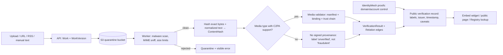
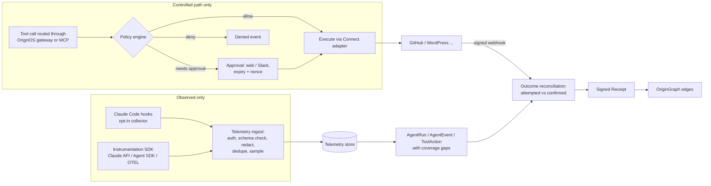
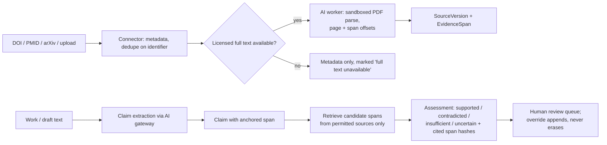
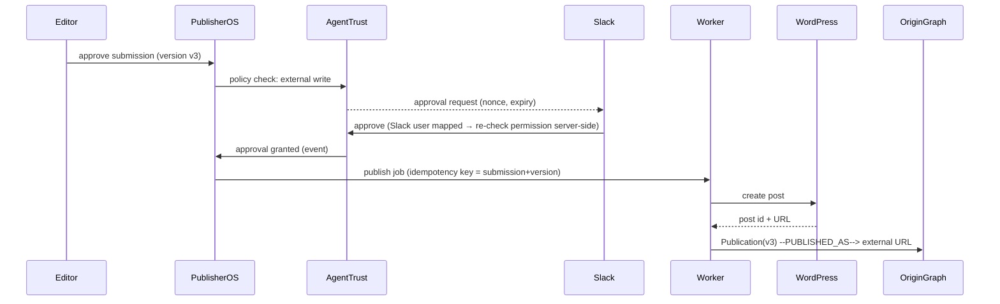

# OriginOS architecture

**Status:** DRAFT v0.1 (Phase 00, 2026-11-22). Target architecture only. **Nothing in this document is implemented yet.** No repository, code, database or deployment exists.
**Sources:** `docs/MASTER_SPEC.md` (authority), `CLAUDE.md`, `PHASES.json`, `prompts/00`–`47`.
**Convention:** items tagged **[GUESS]** are proposals made in Phase 00 without a source in the spec. They need owner confirmation or will be settled by the ADR named next to them. Exact library versions are deliberately not pinned here; Phase 01 pins them from official docs (CLAUDE.md rule 9).

Related: `docs/DECISIONS.md` (ADRs), `docs/PRODUCT_MAP.md` (15 modules), `docs/ACCEPTANCE_MATRIX.md` (traceability), `docs/THREAT_MODEL.md`.

---

## 1. What we are building, in one paragraph

One multi-tenant platform that records **who or what contributed, where content came from, which evidence supports it, what agents were observed doing, who approved it, and what was actually published or changed**. Three product surfaces (public network, private workspace, developer platform) sit on one API, one canonical domain schema, one permission system, one audit/event log and one integration broker. It is explicitly *not* a truth detector, an AI-text detector, or a system that can see agent activity it was not instrumented to see.

## 2. Personas

Prompt 00 lists seven personas; MASTER_SPEC §1 lists six with a single "organization admin". This draft splits that role into team admin and enterprise admin (see ADR-011).

| # | Persona | Primary surface | Top jobs | First phases that serve them |
|---|---|---|---|---|
| P1 | **Creator** (independent) | Private workspace + public profile | Verify domain/accounts, register works and versions, declare AI use and licence, publish proof pages | 09, 11, 14, 31, 33 |
| P2 | **Reader** (often anonymous) | Public network | Discover original work, inspect a verification record without confusing integrity with truth | 14, 31, 32 |
| P3 | **Researcher** | Private workspace | Import papers, map claims to cited passages, inspect disagreement, save reproducible findings | 24–27, 34 |
| P4 | **Editor / publisher** | Private workspace (+ Slack) | Review sources and agent work, request changes, approve, publish to existing channels with an audit trail | 28–30, 22 |
| P5 | **Developer / AI engineer** | Developer console (+ MCP, CLI) | Instrument Claude and other agents, investigate runs, enforce policy on routed actions, use the API/SDK | 16–23, 38 |
| P6 | **Team admin** | Private workspace settings | Invite members, assign roles, connect integrations, manage budgets and consent within one organization | 04, 05, 08, 39 |
| P7 | **Enterprise admin** | Admin console | Multi-workspace policy, retention, legal hold, SSO, incident response, audit export | 05, 41, 42, 44 |

Internal operator roles (support, trust & safety reviewer, rights reviewer) are not product personas but are first-class actors with scoped, audited access (Phase 41).

## 3. System context

```mermaid
flowchart LR
  subgraph Users
    R[Reader] --- C[Creator] --- E[Editor] --- RS[Researcher] --- D[Developer] --- A[Admins]
  end
  subgraph Clients
    WEB[Web app\npublic / workspace / console]
    CL[Claude via remote MCP]
    SL[Slack app]
    HK[Claude Code hook collector\n(local, opt-in)]
    SDK[Instrumentation SDK\nin customer agents]
  end
  subgraph OriginOS
    API[OriginOS API\nmodular monolith]
    WRK[Job/workflow worker]
    MCP[MCP server]
    TEL[Telemetry ingest]
    MED[Media validator\n(sandboxed)]
    AIW[AI/research worker\n(Python)]
  end
  subgraph External
    GH[GitHub]; WP[WordPress / webhooks / RSS]; RES[OpenAlex, Crossref,\nPubMed, arXiv]; LLM[Model providers]; STR[Stripe]; EM[Email provider]; KMS[KMS]
  end
  Users --> WEB --> API
  CL --> MCP --> API
  SL --> API
  HK --> TEL
  SDK --> TEL
  TEL --> API
  API <--> WRK
  WRK --> MED
  WRK --> AIW
  AIW -->|only via AI gateway| API
  WRK --> GH & WP & RES & EM
  API --> LLM
  API --> STR
  API --> KMS
```

## 4. Deployable units and service boundaries

Principle (ADR-001): **one modular monolith for business logic**, plus a small number of separately deployed processes that exist for *isolation* (untrusted input, different runtime, different scaling), not for team topology.

| Unit | Path (Phase 01 scaffold) | Runtime | Owns | Talks to | Why separate |
|---|---|---|---|---|---|
| Web | `apps/web` | Next.js (TS) | UI for 3 surfaces, server-side session handling, SSR of public pages | API only (never the DB) | Different runtime; public pages must be cacheable |
| API | `apps/api` | NestJS + Fastify (TS) | All domain modules (§5), REST/OpenAPI, authz, AI gateway, outbox writes | Postgres, S3, KMS, model providers, Stripe | The monolith |
| Worker | `apps/worker` **[GUESS: not in Phase 01's list; proposed addition]** | TS, same packages as API, different entrypoint | Outbox dispatch, durable jobs, workflow steps, outbound connector calls, scheduled tasks | Postgres, S3, external providers, media validator, AI worker | Long-running and retrying work off the request path |
| MCP server | `apps/mcp-server` | TS, official MCP SDK | Remote MCP transport, OAuth for MCP clients, tool schemas | **API only**, with a user-delegated, audience-bound token | Separate trust boundary for an external AI client (ADR-007) |
| Telemetry ingest | `services/telemetry` | TS | Authenticated OTLP-compatible + custom event ingest, redaction, dedupe, backpressure | Telemetry store, API (registration/ingest-key checks) | Spiky volume; untrusted payloads; must not degrade the API (ADR-008) |
| AI / research worker | `services/ai-worker` | Python | PDF parsing, span anchoring, claim extraction pipelines, eval harness | API's AI gateway (never providers directly), S3 (scoped) | Python ecosystem for document/ML tooling (ADR-004) |
| Media validator | `services/media-validator` **[GUESS: not in Phase 01 list; MASTER_SPEC §4 calls for "services for high-risk file/media processing"]** | C2PA SDK runtime chosen in Phase 12 | C2PA manifest parsing and validation, file sniffing | Nothing outbound (no network egress); called by worker | Parses hostile files; sandbox + resource limits (ADR-005) |

Shared packages: `packages/contracts` (Zod schemas, OpenAPI, event envelopes, canonical IDs), `packages/db` (Drizzle schema + migrations), `packages/ui` (design system), `packages/config` (env validation, lint/ts configs). **[GUESS]** add `packages/authz` (policy evaluation shared by API, worker and MCP) and `packages/signing` (signer interface, KMS adapter, dev-only file signer).

### Boundary rules (enforced by import-boundary lint from Phase 01)

1. Only `apps/api` and `apps/worker` import `packages/db`. Web, MCP server, telemetry ingest and Python worker go through the API or their own narrow store.
2. Inside the API, a module may call another module only through that module's exported service interface. **No module reads another module's tables.**
3. Cross-module side effects travel as domain events through the outbox (ADR-003), not direct calls, unless the caller needs a synchronous answer.
4. Every external provider is reached through an Origin Connect adapter (ADR-009). Every model call goes through the AI gateway (ADR-004). Every signature goes through the signer interface (ADR-006).
5. Every repository function requires a `TenantContext`; there is no "unscoped" query helper outside explicitly named admin/migration code.

## 5. API modules (bounded contexts inside the monolith)

| Context | API modules | Product modules served | Postgres schema **[GUESS: schema-per-context]** |
|---|---|---|---|
| **Core** | tenancy (orgs, workspaces, memberships), auth/session, authz (RBAC + grants + deny), consent, audit, outbox | all | `core` |
| **Trust** | identity (Subject, IdentityClaim, proofs), credentials, provenance (Work/Version hashing, assertions), verification (C2PA results, public records), registry, signing | IdentityMesh, OriginGraph, Origin Registry, Verified Human (badges) | `trust` |
| **Content** | works & versions, library, studio documents, editorial (PublisherOS), distribution, rights (CreatorRights), discovery/directory, newsletters | PublisherOS, Origin Studio, Origin Library, CreatorRights, Verified Human | `content` |
| **Evidence** | sources & source versions, passages/spans, claims, assessments, review queue | EvidenceGraph | `evidence` |
| **Agents** | agents (as Subjects), runs/events query, policy engine, approvals, receipts, outcome reconciliation | AgentTrust | `agents` (query/relational); raw events in `telemetry` |
| **Connect** | provider connections, OAuth broker, token vault, inbound webhooks, outbound delivery, connector registry | Origin Connect, Origin Marketplace | `connect` |
| **Platform** | AI gateway, search/intelligence, automations, analytics, billing/metering, developer API keys, marketplace listings | Origin Intelligence, Automations, Analytics, Marketplace, developer platform | `platform` |
| **Graph** (cross-cutting) | typed Relation store + traversal API | OriginGraph, EvidenceGraph, Registry | `core.relation` (single edge table, ADR-002) |

Rationale for 7 contexts instead of 15 modules: several product modules share the same objects (e.g. Studio, PublisherOS and Library all operate on Work/WorkVersion/Source). Building them as separate backends would duplicate schemas, which CLAUDE.md rule 3 forbids. Product modules are UX + workflow groupings on top of these contexts; see `docs/PRODUCT_MAP.md` for the mapping.

## 6. Canonical domain model (summary)

Full rationale and naming reconciliation in ADR-002. Canonical entities (MASTER_SPEC §3), grouped:

- **Actors:** `Tenant`, `Subject` (kind: human | organization | agent | service), `IdentityClaim`, `Credential`, `Consent`
- **Content:** `Work`, `WorkVersion`, `Asset` (stored bytes), `ContentHash` (exact-bytes and normalized-text, kept separate), `Publication`, `LicenseDeclaration`
- **Provenance:** `ProvenanceAssertion` (optionally signed), `VerificationResult`, `Relation` (typed, provenance-bearing edge)
- **Evidence:** `Source`, `SourceVersion`, `EvidenceSpan`, `Claim`, `Assessment`
- **Agents:** `AgentRun`, `AgentEvent`, `ToolAction`, `Policy`, `Approval`, `Receipt` (signed)
- **Platform:** `Workflow`, `ProviderConnection`, `AuditEvent`

Every evidence-like row carries the spec's required provenance fields: immutable ID, original source/provider, `first_seen_at`, `asserted_by`, `observed_by`, tenant visibility, subject/object IDs, artifact/URL + version, capture method, validation mechanism, limitations, superseded/revoked state, hash/signature. These are a shared column set (**[GUESS]** a Drizzle mixin `evidenceFields`), not per-module re-inventions.

**Assurance labels** are an enum in `packages/contracts`, never free text, with exactly the seven values in MASTER_SPEC §3: `identity_reviewed`, `domain_or_account_controlled`, `signed_provenance_validated`, `creator_declared_ai_use`, `agent_action_observed`, `outcome_confirmed`, `research_claim_assessed`. The UI shows each label with its "how" and "as of" date. There is no aggregate score or "human-made" seal.

IDs: opaque, prefixed, sortable **[GUESS: e.g. `wrk_` + ULID/UUIDv7]**. The prefix makes cross-module references and logs readable without leaking sequence information.

## 7. Target navigation

Phase 03 fixes the private-workspace nav at: Home, Agents, Research, Publish, Trust, Discover, Integrations, Settings. All 15 modules must have a home inside that nav **[GUESS: placement below]**:

| Surface | Nav item | Contains (product module) |
|---|---|---|
| Private workspace | **Home** | Activity feed, pending approvals, Origin Intelligence ask box (also on global command bar ⌘K), workspace Analytics summary |
| | **Agents** | AgentTrust: agents, runs/flight recorder, policies, approvals, receipts, coverage |
| | **Research** | EvidenceGraph (sources, claims, explorer), Origin Library (collections, imports) |
| | **Publish** | Origin Studio (drafts/editor), PublisherOS (submissions, review board, schedule, channels) |
| | **Trust** | IdentityMesh (profile, proofs, credentials), OriginGraph (works, provenance explorer), CreatorRights (licences, requests, disputes), Origin Registry (workspace entries) |
| | **Discover** | Verified Human directory and collections, followed topics, digests (in-app view of the public network) |
| | **Integrations** | Origin Connect (connections, webhooks), Origin Marketplace (listings, installs), Origin Automations (workflows) **[GUESS: Automations could merit its own item later]** |
| | **Settings** | Members & roles, consent, retention, billing & usage (Analytics detail), API keys link |
| Public network | — | `/` discovery, `/c/:handle` creator profile, `/v/:recordId` verification record, `/w/:workId` work page, embed widget, RSS, public Registry lookup |
| Developer console | — | API keys, OAuth apps, MCP setup, telemetry ingest keys + collector install, webhooks, SDK docs, sandbox, usage |
| Admin console (staff) | — | Moderation queues, rights/identity review, incidents, support access log, retention/legal hold |

Unbuilt items render an honest "Not yet available" state with the phase that will deliver them (Phase 03 check), never a working-looking empty dashboard.

## 8. Data flows

### 8.1 Write path and event propagation (all modules)

```mermaid
sequenceDiagram
  participant U as Client
  participant API as API module
  participant DB as Postgres
  participant W as Worker
  participant X as Consumer / external
  U->>API: request (session or API key)
  API->>API: authn → TenantContext → authz (deny by default)
  API->>DB: BEGIN; write domain rows + audit_event + outbox_event; COMMIT
  API-->>U: 2xx with resource + correlation id
  W->>DB: claim outbox batch (SKIP LOCKED)
  W->>X: deliver to consumer (idempotency key = event_id + consumer)
  X-->>W: ok / retryable error / permanent error
  W->>DB: mark done / schedule retry / dead-letter
```

### 8.2 Content provenance (creator → public record)



### 8.3 Agent telemetry, policy and outcome (AgentTrust)



Key distinction drawn in the diagram: telemetry is **observation** of whatever was instrumented; the policy engine **enforces** only on actions that physically pass through OriginOS. The UI must never present observed-only agents as governed.

### 8.4 Evidence (research)



### 8.5 Publish (flagship workflow, MASTER_SPEC §7)



### 8.6 Claude via MCP (read path)

Claude → MCP server (OAuth token, audience = this MCP server, tenant-bound) → API with user-delegated scope → authz → saved records only. Tools return structured, source-linked results. Approval-type tools *create* approval requests; they can never grant them. The MCP server holds no data and no provider credentials.

## 9. Cross-cutting concerns

- **Tenancy:** `tenant_id` on every tenant-owned row; repository layer injects it; **[GUESS, recommended]** Postgres row-level security as defense in depth, decided in Phase 05/06. S3 keys prefixed by tenant, accessed only via short-lived signed URLs issued after authz.
- **Authorization:** RBAC roles + resource grants + explicit deny; actor types human/service/agent; agent principals default to a strict subset of the owning user (Phase 05). One evaluator (`packages/authz`) used by API, worker and MCP.
- **Audit:** append-only `audit_event` written in the same transaction as the change. Signed receipts are a separate, stronger artifact (ADR-006).
- **Observability:** OpenTelemetry traces/logs/metrics for OriginOS itself, correlation ID propagated HTTP → outbox → job → external call. This is separate from AgentTrust customer telemetry (different store, different retention, different access).
- **Secrets:** provider tokens encrypted at rest with envelope encryption via KMS; never returned to clients; log redaction at the logger level, not by convention.
- **AI:** optional. Every AI-dependent feature has a deterministic fallback or an honest "unavailable / queued" state (Phase 15 check).
- **Privacy:** consent records gate directory listing, telemetry collection and public provenance. Public records are *published copies* of selected fields, not views over private tables, so revocation means unpublishing a copy, and private evidence never leaks through a public join.

## 10. Non-goals (ADR-012)

Not building: a blockchain or token; an AI-generated-text detector; a universal trust score or "100% human" seal; access to private Claude conversation history or any uninstrumented agent activity; enforcement over agents that do not route actions through OriginOS; legal determination of ownership; paywall bypass or unconsented scraping; microservices per module; real-time collaborative editing (unless Phase 28 proves the need); self-hosted model inference at launch; executing third-party marketplace code in the main process.

## 11. Release gates

Gates are cumulative. A gate is passed only with linked evidence in `docs/ACCEPTANCE_MATRIX.md`.

| Gate | When | Must be true |
|---|---|---|
| **G0 Architecture** | end of Phase 00 | This doc, ADRs, product map, traceability matrix and threat-model baseline reviewed and accepted by the owner |
| **G1 Foundation** | end of 08 | Clean install + CI green (typecheck, lint, unit, migrations up/down); cross-tenant read/write negative tests pass; secrets scanning in CI; outbox survives worker crash |
| **G2 Trust core** | end of 14 | Assurance labels enforced as enum in contracts and UI; tampered/unsigned/unsupported C2PA fixtures behave correctly; public pages expose only published copies |
| **G3 Agents & integrations** | end of 23 | Replay/duplicate webhook and telemetry tests pass; approvals cannot be bypassed via Slack or MCP; coverage gaps displayed; no claims of universal enforcement anywhere in UI copy |
| **G4 Feature complete (internal)** | end of 40 | Every module either passes its checks or is marked NOT BUILT and hidden/labelled; E2E for the 7 MASTER_SPEC §7 workflows |
| **G5 Release** | 47 | MASTER_SPEC §9 in full: zero known critical/high vulns, backup restore tested, incident runbook, export/erasure policy, defensible identity/provenance messaging reviewed, measured cost envelope |

## 12. Conflicts found in the kit and how this draft resolves them

| # | Conflict | Resolution in this draft |
|---|---|---|
| K1 | README/TRIGGERS rely on `.claude/skills/origin-build`, `origin-audit` and `.claude/agents/` which are not in the kit | Resolved on 2026-11-22 in a separate piece of work: the skills and agents were drafted and copied into the kit's `.claude/`. They are untested until the kit sits at a repo root. |
| K2 | Prompt 00 asks to "inspect the real repository"; no repository exists yet | Phase 00 is docs-only. Repo creation happens at Phase 01. |
| K3 | Personas: 7 in prompt 00 vs 6 in MASTER_SPEC | Use 7 (ADR-011). |
| K4 | Entity names differ: spec §3 (`Asset`, `ProvenanceAssertion`, `ToolAction`) vs PRODUCT_MAP (`Artifact`, `Attestation`, `Action`) vs module table (`Span`, `ExecutionReceipt`, `Paper`, `Derivation`, `AgentIdentity` ...) | Spec §3 names are canonical; module-specific names are mapped in ADR-002 and PRODUCT_MAP. |
| K5 | Phase 01 scaffold has no TS worker or media-validation service, while spec §4 requires workers and isolated media processing | Add `apps/worker` and `services/media-validator` [GUESS]; owner to confirm before Phase 01. |
| K6 | Workflow engine left open ("start pragmatically, Temporal if justified") | Postgres-backed queue behind a `WorkflowRunner` interface now; Temporal re-evaluated at Phase 35 (ADR-003). |
| K7 | Two AI runtimes (TS gateway, Python workers) could each call providers | Python worker calls models only through the TS gateway (ADR-004). |
| K8 | Phase 31 lists 4 disclosure labels, spec §3 lists 7 | Use the spec's 7 everywhere; Phase 31 uses the relevant subset for the directory. |
| K9 | Signing appears in phases 10, 14, 20, 36 with no shared design | One signer interface + key registry (ADR-006). |
| K10 | `ACCEPTANCE_MATRIX.md` phase rows are truncated mid-sentence (~180 chars) | Regenerated in full from PHASES.json, plus a capability-level traceability matrix. |
| K11 | Phase 03 nav has 8 items for 15 modules | Placement table in §7 [GUESS]. |
| K12 | PRODUCT_MAP.md was a stub | Full map drafted. |

## 13. Open questions for the owner

See `PHASE00_REVIEW.md` in the drafts folder; summarised in the thread.
